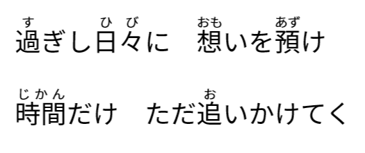

#  Lyrics Helper

Lyrics Helper is a utility for handling ruby text in document files,

especially useful for Japanese lyrics.

## What it can

- Cleaning ruby text.　
- Stripping out ruby text.

<figure>
    
    <figcaption>Original</figcaption>
</figure>
<figure>
    
    <figcaption>Cleaned</figcaption>
</figure>
<figure>
    
    <figcaption>Stripped</figcaption>
</figure>

## How it behaves

### Stripping

Stripping normally replaces the ruby base with its reading.

### Cleaning

Cleaning only rewrites ruby annotations.

## Input support

- Microsoft® Word `.docx` packages and Flat OPC `.xml` packages (the Word 2003 XML Package format, not arbitrary WordprocessingML).

## Resource limits

Documents are treated as untrusted. The application applies the following bounds (see `LyricsHelper/DocumentLimits.cs`):

- at most 4096 zip entries, 64 Word story parts, and 1024 files per dropped directory;
- at most 32 MiB per XML story part, 128 MiB total decompressed content, and 32 million XML characters per part;
- at most 2,000,000 generated XML nodes per Cleaning file;
- at most 512 characters of ruby base and 4096 characters of ruby reading per annotation;
- at most 1,000,000 characters of extracted/displayed text.

## What it can't (yet)

- To *generate* ruby text.
- To support multilingual.
- To resolve ruby colors inherited from Word styles/themes (direct run colors are checked).
