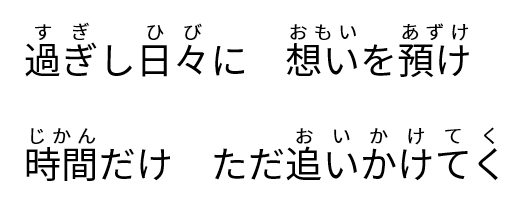
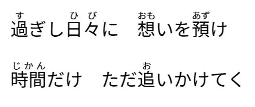
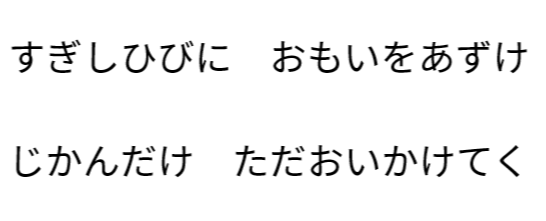

<div align="center">


#  Lyrics Helper

This is a utility processing ruby text in document files,

especially useful for Japanese lyrics.

<div align="left">


## What it can

- Cleaning ruby text.　
- Stripping out ruby text.

<div align="center">
<figure>
    
    <figcaption>Original</figcaption>
</figure>
<figure>
    
    <figcaption>Cleaned</figcaption>
</figure>
<figure>
    
    <figcaption>Stripped</figcaption>
</figure>
<div align="left">

## How it behaves

- **Stripping** normally replaces a ruby base with its reading. A ruby whose reading contains anything other than hiragana (the prolonged sound mark `ー` is allowed) or whose run/reading carries an explicit non-black color is emitted as `[base](reading)` so it can be reviewed instead of silently normalized.
- Three special base types override that default:
  - **Fully-katakana base** (e.g. `アイウエオ`, `キミ`, `コンピューター`): Stripping always emits hiragana and expands `ー` to the preceding vowel. It uses the kana reading when one exists; if the reading is English or otherwise not kana, it normalises the katakana base (`インターネット`/`INTERNET` → `いんたあねっと`, `コンピューター` → `こんぴゅうたあ`, `メモリー` → `めもりい`).
  - **Latin/digit base** (e.g. `Dream`, `Time`, `SNS`, `123`): Stripping emits the base only.
  - **Symbol/punctuation base** (e.g. `☆`, `♪`, `…`, `【`, `】`): Stripping emits the base only.
- **Cleaning** rewrites only `w:ruby` nodes. For the three special base types the ruby is removed entirely (the base remains as plain text); for ordinary kanji/kana bases the existing split behaviour applies. `w:rPr`, `w:rubyPr` and the surrounding run content are preserved, runs split across several `w:r` elements are read as one annotation, and no base text is dropped.
- Results are written next to the input as `*.C.docx` or `*.C.xml`. An existing result is replaced atomically through a temporary file, and a failed run does not leave a partial output behind.
- The result window is shown for every finished task, even when the result is empty; this is the completion signal (success or failure).
- Long results are truncated in the output window, and the extraction result itself is capped.

## Input support

- `.docx` packages and Flat OPC `.xml` packages (the Word 2003 XML Package format, not arbitrary WordprocessingML).
- Transitional and Strict WordprocessingML namespaces.
- Body paragraphs, tables, hyperlinks, content controls, tracked insertions, text boxes, headers, footers, footnotes, endnotes and comments.
- Multi-run ruby and ruby runs that also contain ordinary text.

## Resource limits

Documents are treated as untrusted. The application applies the following bounds (see `LyricsHelper/DocumentLimits.cs`):

- at most 4096 zip entries, 64 Word story parts, and 1024 files per dropped directory;
- at most 32 MiB per XML story part, 128 MiB total decompressed content, and 32 million XML characters per part;
- at most 2,000,000 generated XML nodes per Cleaning file;
- at most 512 characters of ruby base and 4096 characters of ruby reading per annotation;
- at most 1,000,000 characters of extracted/displayed text.

`System.IO.Compression.ZipArchive` is used for the untrusted container path. The SharpCompress package reference is intentionally left unchanged by this release; it is no longer used to parse or rewrite dropped documents.

## Tests

The dependency-free regression project exercises multi-run ruby, table/hyperlink/content-control extraction, Strict OOXML, empty readings, color handling and the katakana/Latin/symbol rules:

```powershell
dotnet run --project tests/LyricsHelper.RegressionTests/LyricsHelper.RegressionTests.csproj
```

## What it can't (yet)

- To *generate* ruby text.
- To support multilingual. ***You can help!***
- To resolve ruby colors inherited from Word styles/themes (direct run colors are checked).
- To process documents not created by Microsoft® Word. ***You can help!***
